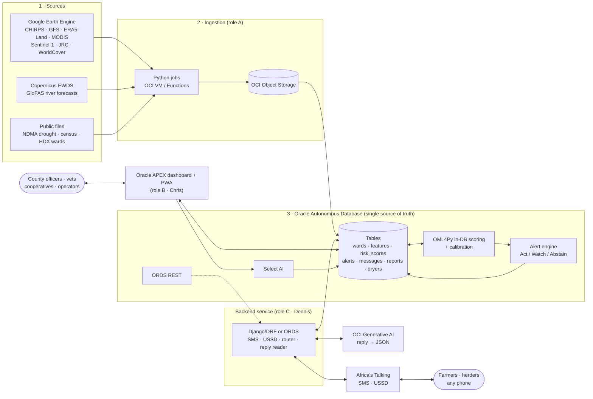
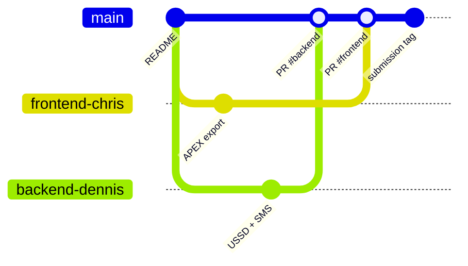

# 🌧️ Ngao · MvuaSmart

**One shield for farmers, herders and county health teams against flood, disease and drought.**
GreenTech Hackathon 2026 (Strathmore × Oracle) · pitch **Fri 16 Oct 2026, 9:30 AM EAT**

Ngao (*ngao* = shield) is an early-warning platform that tells farmers, herders and county teams
**what to do**, days to weeks before floods, disease and drought strike. It runs on **Oracle Cloud**,
reaches people on **any phone by SMS and USSD in Swahili**, and gives county officers **one map
dashboard** built in **Oracle APEX** (also installable as a phone app, an APEX PWA).

| Service | For | What it does |
|---|---|---|
| **MvuaSmart** | Maize farmers, cooperatives, dryer operators | Dry-window & heavy-rain alerts at harvest, aflatoxin advice, field-flood warnings, mobile-dryer routing to wet maize |
| **Ngao Mifugo** | Herders, grazing committees, county vets | River/flash-flood warnings, Rift Valley fever "vaccinate before outbreak", drought grazing options, sell timing |
| **Ngao Afya** | County health teams, community health promoters | Cholera risk after floods, RVF human risk, aflatoxin food-safety risk |

**What makes it different:** every alert carries **one action and a confidence**; the engine says
**Act / Watch / Abstain** and stays silent when unsure; replies in Swahili are read by **OCI
Generative AI (extract only, never advise)**; a **public scorecard** grades every alert.

**Friday demo:** farmer service *live* in **Uasin Gishu** (USSD register → SMS alert → Swahili reply →
dryer routed → booking SMS), then herder + health services through a **replay of the 2006 Rift
Valley fever outbreak in Garissa**, on the shared dashboard.

---

## 📚 Documentation

| Doc | Read it for |
|---|---|
| [docs/ARCHITECTURE.md](docs/ARCHITECTURE.md) | All moving parts, component & data-pipeline diagrams, sequence diagrams, ER diagram |
| [docs/API_CONTRACT.md](docs/API_CONTRACT.md) | **The frontend ↔ backend contract**: tables/views, REST endpoints, Africa's Talking webhooks, error format |
| [docs/ORACLE_APEX.md](docs/ORACLE_APEX.md) | How we use Autonomous DB, APEX, PWA, Select AI, ORDS; exporting APEX into git |
| [docs/EXECUTION_PLAN.md](docs/EXECUTION_PLAN.md) | Wed/Thu/Fri timeline, owners, milestones, cut list, demo script, risks |
| [db/schema.sql](db/schema.sql) | Draft DDL for the shared schema (source of truth) |

## 🗺️ System at a glance



> **Design rule:** the database is the integration point. APEX reads views directly; the backend
> writes to the same schema. Neither side calls the other's internals; see the
> [API contract](docs/API_CONTRACT.md).

## 👥 Team, roles & branches

| Role (brief) | Person | Owns | Works on branch | Folder |
|---|---|---|---|---|
| **A** · Data & models | _TBC_ | Earth Engine exports, ward features, dry-window & heavy-rain models, RVF rule, replays | `data-*` (suggested) | `data/` |
| **B** · Oracle & dashboard | **Chris** | Autonomous DB, tables, OML4Py loading, APEX pages, PWA, Select AI, demo controls | **`frontend-chris`** | `frontend/`, `db/` (shared) |
| **C** · Phones & routing | **Dennis** | Africa's Talking SMS/USSD, REST endpoints, reply reader, alert-engine wiring, dryer router | **`backend-dennis`** | `backend/`, `db/` (shared) |
| **D** · Pitch & partners | _TBC_ | NCPB/county calls, farmer SMS test, slides, backup video, rehearsals | n/a | `docs/pitch/` |

### Branch workflow



1. Work only on your branch, in your folder. Pull `main` into your branch often (`git merge origin/main`).
2. **`db/schema.sql` is shared**: change it in a small PR to `main` first, then merge `main` into your branch. Never change a view or endpoint shape in [API_CONTRACT.md](docs/API_CONTRACT.md) without telling the other person.
3. Open a PR to `main` at each integration milestone (see [Execution plan](docs/EXECUTION_PLAN.md)). **Final merge into `main` by Thu 15 Oct, 2:00 PM EAT**; submission is at 4:00 PM.
4. No secrets in git: keys go in `.env` (git-ignored) or OCI Vault.
5. The old `frontend` and `backend` branches are obsolete (empty copies of `main`). Delete them on GitHub.

## 📁 Repository structure

```text
MVUA-SMART/
├── README.md               ← you are here
├── docs/                   architecture, API contract, APEX guide, execution plan
├── db/
│   └── schema.sql          shared DDL: tables + views (source of truth)
├── frontend/               role B · Chris
│   ├── apex/               APEX app export (fXXX.sql / split export), never hand-edited
│   └── pwa/                PWA settings, icons, install notes
├── backend/                role C · Dennis (Django/DRF service or ORDS handlers)
└── data/                   role A
    ├── pipelines/          Earth Engine & GloFAS ingestion → ward_features_daily
    └── models/             training, calibration, OML4Py scoring scripts
```

## ▶️ How it runs (daily cycle)

| Time (EAT) | Step | Who/what |
|---|---|---|
| 05:00 | Pull new data → `ward_features_daily` | `data/pipelines` (DBMS_SCHEDULER / OCI job) |
| ~05:30 | Score every ward → `risk_scores` (calibrated prob + Act/Watch/Abstain) | OML4Py / SQL rules |
| 06:00 | Send Act alerts to matching subscribers, cooldowns applied | Alert engine → Africa's Talking |
| All day | Replies → OCI GenAI → `reports` (or review queue) | Backend reply reader |
| 18:00 | Plan tomorrow's dryer routes → `routes`, `bookings`; booking SMS | Dryer router |
| Weekly | Match alerts to outcomes → scorecard, recalibrate | SQL job |

For the demo every step is triggered **on cue** from the hidden APEX **Demo controls** page.

### Run it locally / for development
- **Database:** run `db/schema.sql` in the Autonomous DB (SQL Worksheet in Database Actions) under schema `NGAO`.
- **Dashboard:** APEX workspace on the same ADB; import `frontend/apex/` (see [ORACLE_APEX.md](docs/ORACLE_APEX.md)).
- **Backend:** see [backend/README.md](backend/README.md); copy `.env.example` → `.env`, point `AT_*` at the Africa's Talking **sandbox**.
- **Data:** see [data/README.md](data/README.md).

## ✅ Submission checklist (due **Thu 15 Oct 2026, 4:00 PM EAT** → ilabee@strathmore.edu)

- [ ] GitHub repo link (this repo; make sure judges can access it: public or invited)
- [ ] Working app: **APEX workspace / app URL on Oracle Cloud** that judges can open (+ demo login)
- [ ] Project description, **≤ 200 words**
- [ ] Pitch deck, **≤ 5 slides**
- [ ] `frontend-chris` and `backend-dennis` merged into `main` by **2:00 PM**
- [ ] Backup demo video (laptop + USB)
- [ ] Friday 9:30 AM pitch at Strathmore. Bring **National ID**.

## ⚠️ Open decisions (Chris + Dennis)

1. **Django/DRF vs ORDS** for the SMS/USSD webhooks and alert sending. The brief uses ORDS inside the DB; this README originally planned Django. Either works against the same schema; see [ARCHITECTURE.md § Open decisions](docs/ARCHITECTURE.md#open-decisions).
2. Where the Django service is hosted if chosen (OCI Always Free VM + public HTTPS, or a tunnel for the demo).
3. React/Next.js web frontend is **dropped** in favour of APEX + APEX PWA (brief + judging favour Oracle). Reopen only if needed.
