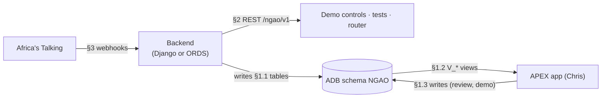

# API & Data Contract (frontend ↔ backend)

This is the agreement that lets **Chris (APEX, `frontend-chris`)** and **Dennis (backend,
`backend-dennis`)** build in parallel. **Change it only by PR to `main`, tagged for the other person.**



Three layers:
1. **Database contract** (primary): tables the backend writes, views APEX reads.
2. **REST API** `/ngao/v1`: actions (run scoring, send alerts, plan routes) and read endpoints for tests and the PWA.
3. **Webhooks** from Africa's Talking.

## 0. Conventions

| Topic | Rule |
|---|---|
| Schema | `NGAO`. Tables UPPER_SNAKE plural (`RISK_SCORES`). Views prefixed `V_`. Packages `PKG_`. |
| Columns | snake_case; PK `<entity>_id`; timestamps `*_at` (`TIMESTAMP WITH TIME ZONE`, stored UTC); dates `*_date`. |
| Enums | Uppercase strings with CHECK constraints: `decision IN ('ACT','WATCH','ABSTAIN')`. |
| Phones | E.164 `+2547XXXXXXXX`. |
| JSON | snake_case keys, ISO-8601 times with offset (`2026-10-15T06:00:00+03:00`), probabilities 0–1, `confidence_pct` 0–100. |
| Versioning | URL prefix `/ngao/v1`. Breaking change → `/v2`; additive fields are non-breaking. Views: add columns freely, **never rename/drop** without a PR. |
| Alert codes | `A1`–`A5`, `B1`–`B4`, `C1`–`C3` (see [ARCHITECTURE §5](ARCHITECTURE.md#alert-catalogue-seed-rows-for-alert_types)). |
| Services | `FARM` (MvuaSmart), `HERD` (Mifugo), `HEALTH` (Afya). |

## 1. Database contract

### 1.1 Tables the backend (Dennis) writes

| Table | Written when | Required columns |
|---|---|---|
| `SUBSCRIBERS` | USSD registration, STOP | phone, ward_id, role, language, consent_at, status |
| `FARMS` / `HERDS` | Registration (optional detail) | subscriber_id, ward_id, crop/species |
| `USSD_SESSIONS` | Each USSD hop | session_id, phone, last_text |
| `MESSAGES` | Every inbound SMS (IN) and every send/DLR update (OUT) | direction, channel, phone, body, provider_msg_id, status |
| `REPORTS` | Reply reader / USSD menu 2 | message_id, ward_id, report_type, report_count, payload, ai_confidence, review_status |
| `ROUTES`, `ROUTE_STOPS`, `BOOKINGS` | Dryer router 18:00 / confirmations | see schema |
| `ALERTS` | Alert engine (if owned by backend; else PL/SQL) | score_id, subscriber_id, alert_type, status |

Data pipeline (role A) writes `WARDS`, `WARD_FEATURES_DAILY`, `FORECASTS`, `RISK_SCORES`.

### 1.2 Views APEX (Chris) reads

| View | APEX page | Key columns |
|---|---|---|
| `V_WARD_RISK_MAP` | Ward risk map | ward_id, ward_name, county, boundary_geojson, service, alert_type, score_date, probability, confidence_pct, decision, abstain_reason, colour |
| `V_WET_MAIZE_POINTS` | Wet maize & dryer planner | point_id, point_name, ward_id, lat, lon, wet_bags_3d, p_heavy_rain_48h, aflatoxin_class, urgency |
| `V_DRYER_PLAN` | Wet maize & dryer planner | route_date, dryer_id, stop_order, point_name, eta, planned_bags, bookings_confirmed |
| `V_REPORTS_INBOX` | Reports inbox | report_id, received_at, ward_name, report_type, report_count, ai_confidence, review_status, lat, lon (ward centroid) |
| `V_REVIEW_QUEUE` | Reports inbox (review tab) | report_id, raw_text, parsed_payload, ai_confidence, reason |
| `V_VET_PRIORITY` | Vet priority list | ward_id, ward_name, rvf_probability, decision, livestock_tlu, sick_reports_7d, rank |
| `V_HEALTH_WATCH` | Health watch list | ward_id, ward_name, cholera_index, rvf_human_decision, flood_flag, neighbour_outbreak (aggregates only) |
| `V_DROUGHT_GRAZING` | Drought & grazing | ward_id, vci3m_now, vci3m_forecast_6w, drought_class, option_id, area_name, score, weekly_tlu_cap, tlu_assigned |
| `V_SCORECARD` | Public scorecard | alert_type, period, alerts_sent, hits, false_alarms, hit_rate, false_alarm_rate, avg_lead_days, brier_skill |
| `V_CALIBRATION` | Scorecard chart | alert_type, prob_bin, predicted, observed, n |
| `V_RVF_REPLAY` | Garissa 2006 replay | replay_date, ward_id, ward_name, rvf_probability, decision, first_case_date, vaccination_date |
| `V_KPI` | Header tiles | wet_bags_today, tonnes_dried_season, alerts_sent_week, act_wards_today |

`colour` convention: ACT = red `#D32F2F`, WATCH = amber `#F9A825`, ABSTAIN = grey `#9E9E9E`, none = green `#388E3C`.

### 1.3 Writes APEX makes
- `REPORTS.review_status` (`ACCEPTED`/`CORRECTED`/`REJECTED`), `reviewed_by`, corrected `payload`.
- Demo controls call **PL/SQL packages or REST §2.2**, never insert alerts directly.
- `ASK_NGAO_LOG` inserts.

## 2. REST API `/ngao/v1`

Base URL (ORDS): `https://<adb-host>.adb.<region>.oraclecloudapps.com/ords/ngao/v1`
Base URL (Django, if chosen): `https://<vm-host>/api/v1` with the **same paths and payloads**.

### 2.0 Auth

| Caller | Mechanism |
|---|---|
| Africa's Talking webhooks | Public path + shared secret in query (`?k=<WEBHOOK_SECRET>`) + IP allow-list where possible **[Assumption]** (AT doesn't sign callbacks) |
| APEX / demo controls / router | OAuth2 client-credentials (ORDS `OAUTH` client) or `Authorization: Bearer <token>` (DRF token) |
| Public scorecard | Unauthenticated `GET /public/scorecard` |

### 2.1 Error format (all endpoints)

```json
{ "error": { "code": "VALIDATION_ERROR", "message": "ward_id is required", "details": {"field": "ward_id"}, "request_id": "8f2c..." } }
```
Codes → HTTP: `VALIDATION_ERROR` 400 · `UNAUTHORIZED` 401 · `FORBIDDEN` 403 · `NOT_FOUND` 404 ·
`CONFLICT` 409 · `UPSTREAM_ERROR` 502 (AT/GenAI) · `INTERNAL` 500.
Webhook endpoints **always return 200** to Africa's Talking (log errors), except USSD, which must return text.

### 2.2 Action endpoints (demo controls + scheduler)

| Method | Path | Body | Effect |
|---|---|---|---|
| POST | `/jobs/score` | `{"as_of":"2026-10-15","county":"Uasin Gishu"}` | Score wards → `RISK_SCORES` |
| POST | `/jobs/send-alerts` | `{"as_of":"2026-10-15","dry_run":false}` | Act alerts → `ALERTS`, `MESSAGES` |
| POST | `/jobs/plan-routes` | `{"route_date":"2026-10-16"}` | Dryer router → routes, bookings, SMS |
| POST | `/jobs/replay` | `{"scenario":"garissa_rvf_2006","from":"2006-09-01","to":"2007-01-15"}` | Fill replay tables |
| POST | `/jobs/reset-demo` | `{}` | Reset demo subscribers/messages |

Response `202`:
```json
{ "job_id": 1042, "job": "send-alerts", "status": "DONE", "summary": {"alerts_created": 14, "messages_queued": 14, "suppressed_cooldown": 3} }
```

### 2.3 Read endpoints

`GET /wards?county=Uasin%20Gishu` →
```json
{ "items": [ {"ward_id": 12, "ward_name": "Moiben", "county": "Uasin Gishu", "centroid": {"lat": 0.82, "lon": 35.38}} ] }
```

`GET /wards/{ward_id}/risk?date=2026-10-15&service=FARM` →
```json
{ "ward_id": 12, "score_date": "2026-10-15",
  "risks": [ {"alert_type": "A1", "probability": 0.75, "confidence_pct": 75, "decision": "ACT", "abstain_reason": null, "model_version": "a1-xgb-2026-10-14-<git sha>"},
             {"alert_type": "A2", "probability": 0.41, "confidence_pct": 41, "decision": "WATCH", "abstain_reason": null} ] }
```

`GET /reports?status=NEEDS_REVIEW&since=2026-10-15T00:00:00+03:00` →
```json
{ "items": [ {"report_id": 77, "ward_id": 12, "report_type": "wet_bags", "report_count": 20, "ai_confidence": 0.62, "review_status": "NEEDS_REVIEW", "raw_text": "magunia 20 mabichi"} ] }
```

`PATCH /reports/{id}` `{"review_status":"CORRECTED","payload":{"report_type":"wet_bags","count":25}}` → `200` updated report.

`GET /routes?date=2026-10-16` →
```json
{ "route_date": "2026-10-16", "routes": [ {"route_id": 5, "dryer_id": 2, "stops": [ {"stop_order": 1, "point_id": 3, "point_name": "Moiben market", "eta": "2026-10-16T08:00:00+03:00", "planned_bags": 140, "urgency": 112.0} ] } ] }
```

`POST /bookings/{id}/confirm` → `{"booking_id": 91, "status": "CONFIRMED"}`

`GET /public/scorecard` → rows of `V_SCORECARD`.

### 2.4 Internal: reply-reader contract (OCI GenAI output)

The model must return **only** this JSON (validated server-side; anything else → `NEEDS_REVIEW`):

```json
{ "report_type": "wet_bags | sick_animals | dead_animals | flooding | water_point_dry | harvested | rain | bags_dried | rvf_signs | booking_confirm | stop | other",
  "count": 20, "unit": "bags | animals | null", "crop": "maize | null", "species": "cattle | goats | sheep | camels | null",
  "rain_reported": true, "moisture_pct": null, "language": "sw | en", "confidence": 0.92 }
```
Rules: `confidence < 0.7` or `report_type = other` → `review_status = NEEDS_REVIEW`. Exact keywords
(`STOP`, `1`, `NDIYO`, `RVF`) are handled **before** the AI call.

## 3. Africa's Talking webhooks

> Field names follow Africa's Talking's documented callbacks (form-encoded POST). Confirm against
> the live AT docs during setup. **[Assumption: verify]**

### 3.1 USSD: `POST /ussd`
Request (`application/x-www-form-urlencoded`):
```
sessionId=ATUid_123&serviceCode=*384*1234#&phoneNumber=+254712345678&networkCode=63902&text=1*1*47*12
```
Response (`text/plain`): starts with `CON ` (continue) or `END ` (finish).
```
CON Chagua kata:
1. Moiben
2. Kapseret
```
Menu tree (from brief): `1 Jiandikishe` → role (1 Mkulima / 2 Mfugaji / 3 Wote) → county → ward →
language → consent; `2 Ripoti` → 1 wet bags (count) / 2 sick-dead animals (type, count) / 3 flooding /
4 water point dry / 5 other (send SMS); `3 Hali ya kata yangu`; `4 Lugha`.
USSD timeouts are short: respond in < 1 s, no GenAI calls on this path.

### 3.2 Inbound SMS: `POST /sms/inbound`
```
from=+254712345678&to=12345&text=Nimevuna magunia 20...&date=2026-10-15 09:12:01&id=abc-123&linkId=...&networkCode=63902
```
Response: `200` empty. Processing (AI parse) may be async.

### 3.3 Delivery reports: `POST /sms/delivery`
```
id=ATXid_9f...&status=Success&phoneNumber=+254712345678&networkCode=63902&failureReason=&retryCount=0
```
Updates `MESSAGES.status` (`SENT` → `DELIVERED` / `FAILED`).

### 3.4 Outbound send (backend → AT)
`POST https://api.sandbox.africastalking.com/version1/messaging` (live: `api.africastalking.com`), header
`apiKey: <AT_API_KEY>`, body `username=sandbox&to=+2547...&message=...&from=<sender id>`. Store the returned
`messageId` in `MESSAGES.provider_msg_id`.

## 4. Message templates
Stored in `ALERT_TYPES.template_sw/en` with slots `{ward}`, `{day}`, `{confidence}`, `{point}`, `{time}`, `{fee}`.
Example A1 (sw): `MvuaSmart: Siku 3 za jua zinatarajiwa kuanzia {day} katika kata yako (uhakika {confidence}%). Vuna mahindi sasa na uyakaushe. Jibu NDIYO ukivuna.`
Keep to ≤ 2 SMS segments. Swahili must be checked by a native speaker.

## 5. Change log
| Version | Date | Change |
|---|---|---|
| v1-draft | 2026-10-14 | Initial contract |
