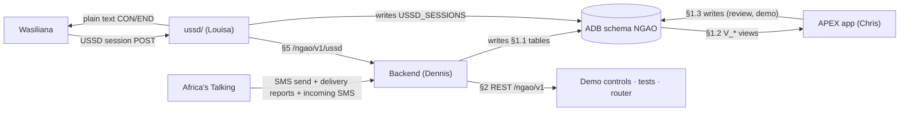

# API & Data Contract (frontend ↔ backend)

This is the agreement that lets **Chris (APEX, `frontend-chris`)**, **Dennis (backend,
`backend-dennis`)**, **Trevor (data, `data-modelling-trevor`)**, **Louisa (USSD, `ussd-louisa`)**, and **Esther — Slides (`slides-esther`)**
build in parallel. **Change it only by PR to `main`, and tag the owners whose folders the change touches.**



Four layers:
1. **Database contract** (primary): tables the backend writes, views APEX reads, sessions Louisa writes.
2. **REST API** `/ngao/v1`: actions (run scoring, send alerts, plan routes) and read endpoints for tests and the PWA.
3. **Providers**: Wasiliana carries the USSD callback to `ussd/`. **Africa's Talking** carries SMS: outbound from the backend, delivery reports and incoming SMS.
4. **USSD to backend** (§5): Louisa calls Dennis for registration, reports, ward status, and unsubscribe. She does not send SMS.

## 0. Conventions

| Topic | Rule |
|---|---|
| Schema | `NGAO`. Tables UPPER_SNAKE plural (`RISK_SCORES`). Views prefixed `V_`. Packages `PKG_`. |
| Columns | snake_case; PK `<entity>_id`; timestamps `*_at` (`TIMESTAMP WITH TIME ZONE`, stored UTC); dates `*_date`. |
| Enums | Uppercase strings with CHECK constraints: `decision IN ('ACT','WATCH','ABSTAIN')`. |
| Phones | E.164 `+2547XXXXXXXX`. |
| JSON | snake_case keys, ISO-8601 times with offset (`2026-10-15T06:00:00+03:00`), probabilities 0–1, `confidence_pct` 0–100. |
| Versioning | URL prefix `/ngao/v1`. Breaking change → `/v2`; additive fields are non-breaking. Views: add columns freely, **never rename/drop** without a PR. |
| Alert codes | `A1`–`A5`, `B1`–`B4`, `C1`–`C3` (see [ARCHITECTURE §5](ARCHITECTURE.md#alert-catalogue-seed-rows-for-alert_types)). |
| Services | `FARM` (MvuaSmart), `HERD` (Mifugo), `HEALTH` (Afya). |

## 1. Database contract

### 1.1 Tables the backend (Dennis) writes

| Table | Written when | Required columns |
|---|---|---|
| `SUBSCRIBERS` | USSD registration via §5, language choice, STOP, SMS `LUGHA`/`LANG` | phone, preferred_lang; coop_id, membership_no, ward_id (from the cooperative), role, consent_at, status once registered |
| `FARMS` / `HERDS` | Registration (optional detail) | subscriber_id, ward_id, crop/species |
| `MESSAGES` | Every inbound SMS (IN) and every send/DLR update (OUT) | direction, channel, phone, body, provider_msg_id, status |
| `REPORTS` | Reply reader / USSD menu 2 via §6 | message_id, ward_id, report_type, report_count, payload, ai_confidence, review_status |
| `ROUTES`, `ROUTE_STOPS`, `BOOKINGS` | Dryer router 18:00 / confirmations | see schema |
| `ALERTS` | Alert engine: one row per eligible subscriber of an ACT score, body rendered from `ALERT_TEMPLATE` and stored in at most 160 characters | score_id, subscriber_id, ward_id, alert_type (all required on the live table), hazard, severity, lang, body, status (`PENDING_APPROVAL` → `APPROVED`/`REJECTED` → `SENT`), approved_by, approved_at, sent_at, message_id |
| `JOB_RUNS` | Every `/jobs/*` call when the table exists. The live NgaoDB has no `JOB_RUNS` table; the job still runs (§2.2) | job_name, params, status, summary |

Louisa (`ussd/`) writes `USSD_SESSIONS` (session_id, phone, last_text, updated_at) on each hop. She does not write `SUBSCRIBERS`, `MESSAGES`, or `REPORTS`.

Trevor (`data/`) writes `WARDS`, `WARD_FEATURES_DAILY`, `FORECASTS`, `RISK_SCORES`.

### 1.2 Views APEX (Chris) reads

| View | APEX page | Key columns |
|---|---|---|
| `V_WARD_RISK_MAP` | Ward risk map | ward_id, ward_name, county, boundary_geojson, service, alert_type, score_date, probability, confidence_pct, decision, abstain_reason, colour |
| `V_WET_MAIZE_POINTS` | Wet maize & dryer planner | point_id, point_name, ward_id, lat, lon, wet_bags_3d, p_heavy_rain_48h, aflatoxin_class, urgency |
| `V_DRYER_PLAN` | Wet maize & dryer planner | route_date, dryer_id, stop_order, point_name, eta, planned_bags, bookings_confirmed |
| `V_REPORTS_INBOX` | Reports inbox | report_id, received_at, ward_name, report_type, report_count, ai_confidence, review_status, lat, lon (ward centroid) |
| `V_REVIEW_QUEUE` | Reports inbox (review tab) | report_id, raw_text, parsed_payload, ai_confidence, reason |
| `V_VET_PRIORITY` | Vet priority list | ward_id, ward_name, rvf_probability, decision, livestock_tlu, sick_reports_7d, rank |
| `V_HEALTH_WATCH` | Health watch list | ward_id, ward_name, cholera_index, rvf_human_decision, flood_flag, neighbour_outbreak (aggregates only) |
| `V_DROUGHT_GRAZING` | Drought & grazing | ward_id, vci3m_now, vci3m_forecast_6w, drought_class, option_id, area_name, score, weekly_tlu_cap, tlu_assigned |
| `V_SCORECARD` | Public scorecard | alert_type, period, alerts_sent, hits, false_alarms, hit_rate, false_alarm_rate, avg_lead_days, brier_skill |
| `V_CALIBRATION` | Scorecard chart | alert_type, prob_bin, predicted, observed, n |
| `V_RVF_REPLAY` | Garissa 2006 replay | replay_date, ward_id, ward_name, rvf_probability, decision, first_case_date, vaccination_date |
| `V_KPI` | Header tiles | wet_bags_today, tonnes_dried_season, alerts_sent_week, act_wards_today |

`colour` convention: ACT = red `#D32F2F`, WATCH = amber `#F9A825`, ABSTAIN = grey `#9E9E9E`, none = green `#388E3C`.

### 1.3 Writes APEX makes
- `REPORTS.review_status` (`ACCEPTED`/`CORRECTED`/`REJECTED`), `reviewed_by`, corrected `payload`.
- `ALERTS.status` `PENDING_APPROVAL` → `APPROVED` or `REJECTED`, with `approved_by`, `approved_at` (Alert Approvals page). Each row is already one subscriber. The backend queues one `MESSAGES` row and stores its id in `ALERTS.MESSAGE_ID` (live `MESSAGES` has no `alert_id`), then sets `SENT` and `sent_at`. It never sends replay alerts or approvals older than 48 h.
- Demo controls call **PL/SQL packages or REST §2.2**, never insert alerts directly.
- `ASK_NGAO_LOG` inserts.

## 2. REST API `/ngao/v1`

Base URL (ORDS): `https://<adb-host>.adb.<region>.oraclecloudapps.com/ords/ngao/v1`
Base URL (Django, if chosen): `https://<vm-host>/api/v1` with the **same paths and payloads**.

### 2.0 Auth

| Caller | Mechanism |
|---|---|
| Africa's Talking SMS callbacks | Public URL with `?k=<WEBHOOK_SECRET>` (AT does not sign callbacks); a wrong secret is ignored silently |
| Wasiliana USSD callback (to `ussd/`) | Public callback URL; check per [ussd/README.md](../ussd/README.md) |
| Louisa's USSD service calling §6 | `Authorization: Bearer <USSD_SERVICE_TOKEN>` |
| APEX / demo controls / router | OAuth2 client-credentials (ORDS `OAUTH` client) or `Authorization: Bearer <token>` (DRF token) |
| Public scorecard | Unauthenticated `GET /public/scorecard` |

### 2.1 Error format (all endpoints)

```json
{ "error": { "code": "VALIDATION_ERROR", "message": "ward_id is required", "details": {"field": "ward_id"}, "request_id": "8f2c..." } }
```
Codes → HTTP: `VALIDATION_ERROR` 400 · `UNAUTHORIZED` 401 · `FORBIDDEN` 403 · `NOT_FOUND` 404 ·
`CONFLICT` 409 · `UPSTREAM_ERROR` 502 (SMS provider/GenAI) · `INTERNAL` 500.
SMS webhook endpoints **always return 200** to Africa's Talking (log errors). The USSD callback is the exception: it must return plain text within ~10 seconds.

### 2.2 Action endpoints (demo controls + scheduler)

| Method | Path | Body | Effect |
|---|---|---|---|
| POST | `/jobs/score` | `{"as_of":"2026-10-15","county":"Uasin Gishu"}` | Score wards → `RISK_SCORES` |
| POST | `/jobs/send-alerts` | `{"as_of":"2026-10-15","dry_run":false}` | Act alerts → `ALERTS`, `MESSAGES` |
| POST | `/jobs/plan-routes` | `{"route_date":"2026-10-16"}` | Dryer router → routes, bookings, SMS |
| POST | `/jobs/replay` | `{"scenario":"garissa_rvf_2006","from":"2006-09-01","to":"2007-01-15"}` | Fill replay tables |
| POST | `/jobs/reset-demo` | `{}` | Reset demo subscribers/messages |
| POST | `/jobs/dispatch` | `{"retry_failed":false}` | Fan out `APPROVED` alerts and send queued SMS now (additive) |
| POST | `/jobs/grade-outcomes` | `{"as_of":"2026-10-15"}` | Grade passed A1/A2 windows → `OUTCOMES` (additive) |

Response `202`:
```json
{ "job_id": 1042, "job": "send-alerts", "status": "DONE", "summary": {"alerts_created": 14, "messages_queued": 14, "suppressed_cooldown": 3} }
```

### 2.3 Read endpoints

`GET /wards?county=Uasin%20Gishu` →
```json
{ "items": [ {"ward_id": 12, "ward_name": "Moiben", "county": "Uasin Gishu", "centroid": {"lat": 0.82, "lon": 35.38}} ] }
```

`GET /wards/{ward_id}/risk?date=2026-10-15&service=FARM` →
```json
{ "ward_id": 12, "score_date": "2026-10-15",
  "risks": [ {"alert_type": "A1", "probability": 0.75, "confidence_pct": 75, "decision": "ACT", "abstain_reason": null, "model_version": "a1-xgb-2026-10-14-<git sha>"},
             {"alert_type": "A2", "probability": 0.41, "confidence_pct": 41, "decision": "WATCH", "abstain_reason": null} ] }
```

`GET /reports?status=NEEDS_REVIEW&since=2026-10-15T00:00:00+03:00` →
```json
{ "items": [ {"report_id": 77, "ward_id": 12, "report_type": "wet_bags", "report_count": 20, "ai_confidence": 0.62, "review_status": "NEEDS_REVIEW", "raw_text": "magunia 20 mabichi"} ] }
```

`PATCH /reports/{id}` `{"review_status":"CORRECTED","payload":{"report_type":"wet_bags","count":25}}` → `200` updated report.

`GET /routes?date=2026-10-16` →
```json
{ "route_date": "2026-10-16", "routes": [ {"route_id": 5, "dryer_id": 2, "stops": [ {"stop_order": 1, "point_id": 3, "point_name": "Moiben market", "eta": "2026-10-16T08:00:00+03:00", "planned_bags": 140, "urgency": 112.0} ] } ] }
```

`POST /bookings/{id}/confirm` → `{"booking_id": 91, "status": "CONFIRMED"}`

`GET /public/scorecard` → rows of `V_SCORECARD`.

Additive (v1-draft.4): `GET /alerts?status=PENDING_APPROVAL`, `POST /alerts/{id}/approve` and `/reject` `{"approved_by":"..."}` (same effect as the APEX page), `GET /jobs/{job_id}/status`, `GET /public/calibration` (rows of `V_CALIBRATION`), `GET /health` (unauthenticated), `POST /demo/inbound-sms` `{"phone","text"}` (the §3.4 reply path without Wasiliana forwarding, API token).

### 2.4 Internal: reply-reader contract (OCI GenAI output)

The model must return **only** this JSON (validated server-side; anything else → `NEEDS_REVIEW`):

```json
{ "report_type": "wet_bags | sick_animals | dead_animals | flooding | water_point_dry | harvested | rain | bags_dried | rvf_signs | booking_confirm | stop | other",
  "count": 20, "unit": "bags | animals | null", "crop": "maize | null", "species": "cattle | goats | sheep | camels | null",
  "rain_reported": true, "moisture_pct": null, "language": "sw | en", "confidence": 0.92 }
```
Rules: `confidence < 0.7` or `report_type = other` → `review_status = NEEDS_REVIEW`. Exact keywords
(`STOP`, `1`, `NDIYO`, `RVF`, and `LUGHA` or `LANG` followed by `SW` or `EN`) are handled **before** the AI call. `language` in the JSON is `sw` or `en` (Swahili or English, chosen by the user).

## 3. Providers: Wasiliana (USSD) and Africa's Talking (SMS)

USSD runs on **Wasiliana** (Louisa's `ussd/`). SMS runs on **Africa's Talking** (the backend); Wasiliana SMS
stays in the backend as a fallback (`SMS_BACKEND=wasiliana`).

Two callback surfaces, two owners:

| Surface | Provider | Who receives it | Owner |
|---|---|---|---|
| USSD session callback | Wasiliana | `ussd/` public URL | Louisa |
| Outbound SMS, delivery reports, incoming SMS | Africa's Talking | `backend/` | Dennis |

### 3.1 USSD callback mode

Wasiliana does not let us dial the user. We register a service code and a callback URL. On each hop Wasiliana **POSTs the session to that URL**. Louisa's service answers with **`text/plain`**, the body prefixed **`CON `** (session continues) or **`END `** (session ends), **within ~10 seconds**. No OCI GenAI call on this path.

Examples when `preferred_lang` is `sw` (the same screens are sent in English when the user chose English):

```
CON Chagua kata:
1. Moiben
2. Kapseret
```

```
END Asante! Umesajiliwa.
```

**Confirm exact request field names against Wasiliana docs ([docs.wasiliana.com](https://docs.wasiliana.com)).** The handler needs a session id, the subscriber phone number, and the text entered so far. Do not hard-code a guessed JSON or form body; isolate the parse in one adapter in `ussd/`.

Screen text is in Swahili or English, chosen by the user. On a new number the first screen is the language prompt in §5; that choice is saved to `preferred_lang` before the menu below. Main menu: `1` Register / Jiandikishe → role (farmer / herder / both) → **cooperative** (numbered list of real societies from `COOPERATIVES` where `is_demo = 'N'`, plus Other / not listed) → **membership number** (skipped for Other) → consent. County and ward are not asked; the ward comes from the cooperative; `2` Report / Ripoti → wet bags (count), sick or dead animals (type, count), flooding, water point dry, or other (ask them to send an SMS; Louisa does not send one); `3` Ward status / Hali ya kata yangu; `4` **Lugha / Language** (change `preferred_lang`, then continue in the new language); `5` Stop alerts / Acha ujumbe (confirm, then `/ussd/unsubscribe`); `6` El Niño advice / Ushauri wa El Niño (static tips, no backend call); `7` **Dry wet maize / Kausha mahindi** (request drying, or confirm a slot the dryer router offered; see §5).

Registration, reports, ward status, and unsubscribe go through [§5](#5-ussd-to-backend-contract). Louisa writes only `USSD_SESSIONS`.

### 3.2 Outbound SMS (Dennis → Africa's Talking)

Dennis is the only sender. The alert engine and dryer router queue rows in `MESSAGES` (`direction=OUT`, `status=QUEUED`). A worker dequeues them and calls Africa's Talking (shape from the official `africastalking` Python SDK):

```
POST https://api.africastalking.com/version1/messaging          (sandbox: https://api.sandbox.africastalking.com/...)
apiKey: <AT_API_KEY>       Accept: application/json       Content-Type: application/x-www-form-urlencoded
username=<AT_USERNAME>&to=+254712345678&message=...&bulkSMSMode=1[&from=<AT_SENDER_ID>]
```
Response: `{"SMSMessageData": {"Message": "Sent to 1/1 ...", "Recipients": [{"statusCode": 101, "number": "+2547...", "status": "Success", "cost": "KES 0.8000", "messageId": "ATXid_..."}]}}`. Store `messageId` in `MESSAGES.provider_msg_id`. `statusCode` 100/101/102 = accepted; 500/501/502 = retry; anything else (e.g. 403 InvalidPhoneNumber, 405 InsufficientBalance, 406 UserInBlacklist) = `FAILED`. `AT_USERNAME=sandbox` sends to the AT simulator only.

### 3.3 Delivery reports

Africa's Talking POSTs (form-encoded) to `POST /sms/delivery?k=<WEBHOOK_SECRET>`:
```
id=ATXid_...&status=Success&phoneNumber=+254712345678&networkCode=63902&failureReason=&retryCount=0
```
`id` matches `MESSAGES.provider_msg_id`. `Success` → `DELIVERED`; `Failed` / `Rejected` → `FAILED`; `Sent`, `Submitted`, `Buffered` are not final and change nothing. Response: `200` empty, always; raw bodies are logged.

### 3.4 Incoming SMS

Needs a shortcode (sandbox shortcodes are free; live: dedicated, or shared + keyword) whose incoming-messages callback is `POST /sms/inbound?k=<WEBHOOK_SECRET>` (form-encoded):
```
from=+254712345678&to=12345&text=Nimevuna magunia 20...&date=2026-10-15 09:12:01&id=...&linkId=...&networkCode=63902
```
→ insert `MESSAGES` (`direction=IN`) → keywords `STOP`, `1`, `NDIYO`, `RVF`, and `LUGHA` or `LANG` followed by `SW` or `EN` (§5) before any GenAI call → reply reader (§2.4). The handler returns `200` immediately; processing is async. Until a shortcode is set up, `POST /demo/inbound-sms` and USSD menu 2 (§5) cover the reply path.

## 4. Message templates
Alerts are rendered from `ALERT_TEMPLATE` using the subscriber's `preferred_lang` (Swahili or English, chosen by the user). The unique key is `(hazard, severity, lang)` with `lang` in (`sw`, `en`) and `body` `VARCHAR2(160)`. Slots: `{ward}`, `{day}`, `{confidence}`, `{point}`, `{time}`, `{fee}`.
Example A1 (`lang` sw): `MvuaSmart: Siku 3 za jua zinatarajiwa kuanzia {day} katika kata yako (uhakika {confidence}%). Vuna mahindi sasa na uyakaushe. Jibu NDIYO ukivuna.`
The English row for the same hazard and severity is the `lang` `en` body. Keep to ≤ 2 SMS segments (the column is 160 characters). Each language's copy must be checked by a native speaker.

## 5. USSD to backend contract

Folder: **`ussd/`** at the repo root (Louisa, branch `ussd-louisa`), so her work has its own tree next to `backend/`. See [ussd/README.md](../ussd/README.md).

Louisa owns the Wasiliana callback, the menu state machine, and `USSD_SESSIONS`. Dennis owns durable rows and every SMS. Louisa calls the endpoints below on the same host and paths as §2 (`/ngao/v1` on ORDS or Django). Auth: `Authorization: Bearer <USSD_SERVICE_TOKEN>`.

The USSD reply to Wasiliana is still due within ~10 seconds, so these endpoints must answer in well under that (target under 2 seconds) and must not call OCI GenAI.

Menus and SMS are in Swahili or English, chosen by the user (`SUBSCRIBERS.preferred_lang`: `sw` or `en`, default `sw`).

**First session.** On a new number's first session, before any other menu, reply with exactly:

```
CON Chagua lugha / Choose language
1. Kiswahili
2. English
```

`1` saves `preferred_lang = 'sw'`. `2` saves `preferred_lang = 'en'`. Call `POST /ussd/language` (below) so the choice is stored before the next screen. Then show the main menu in that language.

**Change it later.** The main menu includes **Lugha / Language**. Choosing it shows the same two options, writes the new `preferred_lang`, and continues in the new language.

**SMS keywords.** An inbound SMS of `LUGHA` or `LANG` followed by `SW` or `EN` (case-insensitive; forms `LUGHA SW`, `LUGHA EN`, `LANG SW`, `LANG EN`) sets `preferred_lang` to `sw` or `en` and sends a confirmation in the new language (Kiswahili confirmation when the new value is `sw`, English confirmation when it is `en`). Do not change `preferred_lang` if the second token is missing. Handle these keywords before any GenAI call.

**Alerts.** Outbound alerts are rendered from `ALERT_TEMPLATE` (`body` for the matching `hazard`, `severity`, and `lang` = the subscriber's `preferred_lang`). See §4.

| Method | Path | Body | Effect |
|---|---|---|---|
| POST | `/ussd/language` | `{"phone":"+254712345678","preferred_lang":"sw"}` | Set `SUBSCRIBERS.preferred_lang` to `sw` or `en`. Create the subscriber row when the phone is new (phone + `preferred_lang` + `status`) so the choice is saved before registration finishes; registration fills role, ward, and consent. `200` `{"preferred_lang":"sw"}` |
| POST | `/ussd/register` | `{"phone":"+254712345678","ward_id":12,"coop_id":17,"membership_no":"TF-0042","role":"farmer","preferred_lang":"sw","consent":true}` | MERGE `SUBSCRIBERS`, including `preferred_lang` (`sw` or `en`). USSD sends `ward_id` from the chosen cooperative (`COOPERATIVES.ward_id`) and omits it when that is null or the farmer chose Other / not listed. `coop_id` and `membership_no` are additive: store them on `SUBSCRIBERS`; both are null for Other. Membership numbers arrive uppercase (`A-Z 0-9 / -`, ≤ 20) and are stored as given, to be verified with the cooperative. **Requested change:** accept a missing `ward_id` (take it from `coop_id` when present, else leave it null) so Other and unconfirmed-ward farmers can register. `201` `{"subscriber_id":44,"status":"ACTIVE"}` |
| POST | `/ussd/report` | `{"phone":"+254712345678","session_id":"s1","report_type":"wet_bags","count":20,"unit":"bags"}` | INSERT `REPORTS` with `source=USSD`, `review_status=AUTO_ACCEPTED` (a structured menu, not an AI parse). `201` `{"report_id":77}` |
| GET | `/ussd/ward-status?phone=+254712345678` | — | Short line in Swahili or English, chosen by the user, for menu 3 (today's decision for the subscriber's ward, or a sentence that says we have no score). `200` `{"text":"Kata ya Moiben: siku za jua, uhakika 75%."}` when `preferred_lang` is `sw` |
| POST | `/ussd/unsubscribe` | `{"phone":"+254712345678"}` | `SUBSCRIBERS.status=STOPPED`. `200` `{"status":"STOPPED"}` |
| GET | `/ussd/drying?phone=+254712345678` | — | **[Menu 7]** Drying state for the subscriber. `booking` = their next `BOOKINGS` row with status `OFFERED` or `CONFIRMED` and a stop `eta` in the future (null if none). `points` = `COLLECTION_POINTS` in their ward. `200` `{"registered":true,"booking":{"booking_id":91,"status":"OFFERED","point_name":"Moiben market","eta":"2026-10-16T08:00:00+03:00","route_date":"2026-10-16","bags":20,"fee_kes":4200},"points":[{"point_id":3,"point_name":"Moiben market"}]}`. Unknown phone → `200` `{"registered":false,"booking":null,"points":[]}` |
| POST | `/ussd/drying/confirm` | `{"phone":"+254712345678","booking_id":91}` | **[Menu 7]** Same effect as `POST /bookings/{id}/confirm` (§2.3), with a check that the booking belongs to this phone. `200` `{"booking_id":91,"status":"CONFIRMED"}`; `404` if not theirs; `409` if `DRIED` or `NO_SHOW` (confirming twice is harmless) |

**Drying request (menu 7).** `POST /ussd/report` may carry an optional `point_id` (additive): a `wet_bags` report with `point_id` means the farmer asked for drying at that collection point. Store it in `REPORTS.payload` so the 18:00 dryer router can count wet bags per point and create the `OFFERED` booking and A5 SMS. The router should count only the latest `wet_bags` report per subscriber in its 3-day window, since a farmer may report in menu 2 and then request in menu 7.

`report_type` uses the same set as §2.4. Menu 2 only sends types the menu collected (wet bags, sick or dead animals, flooding, water point dry). "Other" tells the farmer to send an SMS; it does not call `/ussd/report`.

Errors use §2.1. A 4xx/5xx from these endpoints is Louisa's problem to turn into an `END` screen in Swahili or English, chosen by the user (for `sw`: `END Samahani, jaribu tena.`). She must not leave Wasiliana waiting.

Session rows stay in `ussd/`: each hop upserts `USSD_SESSIONS` (`session_id`, `phone`, `last_text`, `updated_at`). Dennis may read that table; he does not advance the menu.

## 6. Change log
| Version | Date | Change |
|---|---|---|
| v1-draft | 2026-10-14 | Initial contract |
| v1-draft.2 | 2026-10-14 | Wasiliana replaces Africa's Talking. USSD service is `ussd/` (Louisa); §5 is the USSD to backend contract. Inbound SMS forwarding and delivery-report field names left open pending docs.wasiliana.com |
| v1-draft.3 | 2026-10-14 | Language choice: `preferred_lang`, first-session prompt, main-menu Lugha / Language, SMS `LUGHA`/`LANG`, alerts rendered from `ALERT_TEMPLATE` |
| v1-draft.4 | 2026-10-14 | USSD main menu items 5–7 (Stop alerts, El Niño advice, Dry wet maize). Proposed §5 `GET /ussd/drying`, `POST /ussd/drying/confirm`, optional `point_id` on `/ussd/report` |
| v1-draft.5 | 2026-10-14 | Alert approval workflow as built in APEX (`PENDING_APPROVAL`/`APPROVED`/`REJECTED`/`SENT`); additive endpoints (`/jobs/dispatch`, `/jobs/grade-outcomes`, `/alerts/*`, `/jobs/{id}/status`, `/public/calibration`, `/health`, `/demo/inbound-sms`). Do **not** run `db/migrations/001_backend_alignment.sql` on the live NgaoDB. The backend writes the live per-subscriber `ALERTS` row (`MESSAGE_ID` on the alert, no `JOB_RUNS`). |
| v1-draft.6 | 2026-10-14 | SMS moves to **Africa's Talking** (send, delivery reports, incoming SMS; §3.2–3.4, form-encoded callbacks). USSD stays on Wasiliana (`ussd/`, unchanged). Wasiliana SMS kept as a backend fallback |
| v1-draft.7 | 2026-10-15 | §5 menu 7 implemented: `GET /ussd/drying`, `POST /ussd/drying/confirm`; `point_id` on `/ussd/report` is stored and the 18:00 router books that point. `fee_kes` is the booking total. APEX can call §2.2 through the `NGAO_BACKEND` PL/SQL package (`db/deploy/020_backend_bridge.sql`). Backend + USSD deploy: [DEPLOY_VM.md](DEPLOY_VM.md) |
| v1-draft.8 | 2026-10-15 | Seasonal outlook (v3 model, [SEASONAL_MODEL.md](SEASONAL_MODEL.md)): `POST /jobs/seasonal-outlook`, `GET /seasonal/outlook`, `GET /public/seasonal-model-card`, §5 `GET /ussd/seasonal-outlook` (USSD menu 6 title). Backend writes `SEASONAL_OUTLOOK`, `SEASONAL_MODEL_RUNS`, `SEASONAL_BACKTEST` and alert type `S1` scores (`db/deploy/030_seasonal_alert.sql`) |
| v1-draft.9 | 2026-10-15 | USSD registration asks for cooperative + membership number instead of county + ward. `/ussd/register` adds `coop_id` and `membership_no`; USSD sends `ward_id` from the chosen cooperative. **Requested:** make `ward_id` optional when `coop_id` is given (or for Other), and store `coop_id` + `membership_no`. `db/deploy/040_cooperatives_registry.sql` adds `short_name`, `sub_county`, `location_basis`, `coop_type`, `source_url` to `COOPERATIVES` and `membership_no` to `SUBSCRIBERS`, and merges 14 real societies (`is_demo = 'N'`) |
