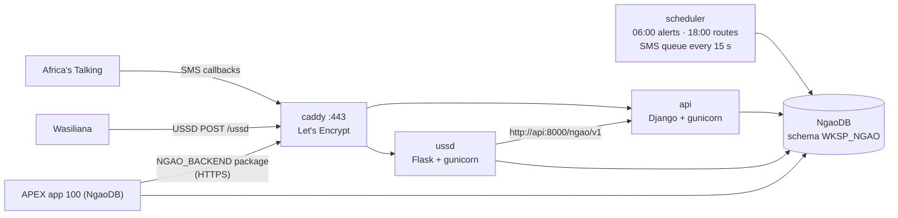

# Deploying the backend and USSD service to the Oracle VM

Pushes to `main` that touch `backend/`, `ussd/` or `deploy/vm/` run `.github/workflows/deploy-vm.yml`:

1. **Test**: backend tests (Python 3.13), USSD tests (Python 3.12), the USSD service driving a real backend end to end (`ussd/tests/test_backend_e2e.py`), and checks on the deploy scripts, Compose file and Caddyfile.
2. **Build**: `ghcr.io/<owner>/ngao-backend` and `ghcr.io/<owner>/ngao-ussd`, for `linux/amd64` and `linux/arm64` (Always Free Ampere A1 VMs are ARM), tagged with the commit SHA and `main`.
3. **Deploy**: SSH to the VM, install Docker on first run, upload the Compose bundle, env files and the database wallet to `/opt/ngao`, check the live schema with the new image, then `docker compose up -d`.
4. **Smoke test**: `https://<host>/ngao/v1/health` must answer 200 with `"database":"oracle"`, the USSD health check must answer, and `/wards` must refuse a request without a token.

Pull requests run step 1 and build the amd64 images without pushing. They get no secrets and never connect to the VM or NgaoDB.

NgaoDB itself (schema scripts and the APEX app) is deployed by the other workflow, `deploy-ngaodb.yml`. See [DEPLOY.md](DEPLOY.md).

## What runs on the VM



| Service | What it does |
|---|---|
| `caddy` | HTTPS on 443 (HTTP 80 redirects). Certificates come from Let's Encrypt for `NGAO_DOMAIN`, or for `<vm-ip>.sslip.io` when no domain is set. |
| `api` | Django REST API (`/ngao/v1`, `/api/v1`, Swagger UI at `/ngao/v1/docs/`), SMS webhooks, the USSD contract. |
| `scheduler` | The daily cycle and the outbound SMS queue. Alerts an officer approves in APEX are sent within about 15 seconds. |
| `ussd` | Wasiliana USSD callback at `/ussd`. Reads wards and languages from NgaoDB and writes through the backend. |

## One-time setup

### 1. The VM

- An OCI compute instance with a public IP. Oracle Linux 8/9 or Ubuntu 22.04/24.04, x86_64 or Ampere A1. Ampere A1 with 1 OCPU / 6 GB is comfortable. The 1 GB E2.1.Micro shape works but is tight.
- **Ingress rules**: in the VM subnet's security list (or the instance NSG), allow TCP 80 and TCP 443 from `0.0.0.0/0`. The deploy opens the VM's own firewall (firewalld or iptables), but it cannot change OCI networking.
- The SSH user is the image default (`opc` on Oracle Linux, `ubuntu` on Ubuntu). It has passwordless sudo, which the first deploy uses once to install Docker (`deploy/vm/bootstrap.sh`).

### 2. NgaoDB access from the VM

The VM connects with the same instance wallet as the NgaoDB workflow. Python's thin driver also needs the **wallet password** you chose when downloading the wallet, because it opens `ewallet.pem`.

If the Autonomous Database has an access control list, add the VM's public IP to it.

### 3. Secrets

Add these under **Settings → Secrets and variables → Actions**. The NgaoDB workflow already uses the four `NGAO_DB_*` wallet and login secrets, so only add what is missing.

**Required**

| Secret | Value |
|---|---|
| `NGAO_VM_HOST` | The VM's public IP (or a DNS name that points to it) |
| `NGAO_VM_USER` | `opc` or `ubuntu` |
| `NGAO_VM_SSH_KEY` | Private key (OpenSSH format) whose public key is in the VM's `~/.ssh/authorized_keys` |
| `NGAO_DB_WALLET_B64` | Base64 of the instance wallet zip (same as for `deploy-ngaodb.yml`) |
| `NGAO_DB_USER` | `WKSP_NGAO` (or `ADMIN`; the services then work in `NGAO_DB_SCHEMA`) |
| `NGAO_DB_PASSWORD` | That user's password |
| `NGAO_DB_SERVICE` | TNS alias from the wallet, e.g. `ngaodb_low`. Or set `NGAO_DB_DSN` to a full connect descriptor instead. |
| `NGAO_DB_WALLET_PASSWORD` | The wallet password set when the wallet was downloaded |
| `DJANGO_SECRET_KEY` | `python3 -c "import secrets; print(secrets.token_urlsafe(50))"` |
| `NGAO_API_TOKENS` | Comma-separated bearer tokens for APEX and operators: `openssl rand -hex 24` each |
| `USSD_SERVICE_TOKEN` | `openssl rand -hex 24`. Used between the two containers. |
| `WEBHOOK_SECRET` | `openssl rand -hex 16`. Appended as `?k=` to the Africa's Talking and Wasiliana callback URLs. |

**Optional**

| Secret / variable | Default |
|---|---|
| `NGAO_DOMAIN` | unset → `<vm-ip>.sslip.io` (a free DNS name that resolves to the IP, so Let's Encrypt works without buying a domain) |
| `NGAO_VM_KNOWN_HOSTS` | unset → the host key is trusted on first sight (`ssh-keyscan`), with a warning. Set it to the output of `ssh-keyscan <vm-ip>` to pin it. |
| `NGAO_VM_SSH_PORT` | `22` |
| `NGAO_DB_SCHEMA` | `WKSP_NGAO` |
| `AT_USERNAME`, `AT_API_KEY`, `AT_SENDER_ID` | Africa's Talking. With `AT_API_KEY` set, `SMS_BACKEND` becomes `africastalking`. Without it, SMS is logged only (`console`). |
| `SMS_BACKEND` | Override the above (`console`, `africastalking`, `wasiliana`) |
| `DEMO_PHONES` | Presenter phones that always receive real SMS |
| `USSD_WEBHOOK_SECRET` | `WEBHOOK_SECRET` |
| `CDSAPI_KEY` | Copernicus CDS key for ERA5 winds/pressure in the seasonal outlook (see [SEASONAL_MODEL.md](SEASONAL_MODEL.md)) |
| Variables: `ALERTS_REQUIRE_APPROVAL`, `REPLY_READER`, `SEASONAL_FEATURE_SOURCE`, `LOG_LEVEL` | backend defaults |

If a required secret is missing, the deploy job fails and names it. Nothing is uploaded and no connection is made.

### 4. After the first green deploy

The job summary lists the URLs. Configure them once:

| Where | URL |
|---|---|
| Africa's Talking → SMS → Delivery reports callback | `https://<host>/ngao/v1/sms/delivery?k=<WEBHOOK_SECRET>` |
| Africa's Talking → SMS → Incoming messages callback | `https://<host>/ngao/v1/sms/inbound?k=<WEBHOOK_SECRET>` |
| Wasiliana → USSD service callback | `https://<host>/ussd?k=<WEBHOOK_SECRET>` |
| APEX → Workspace Utilities → Web Credentials → **Create** | Static ID `NGAO_BACKEND`, type *HTTP Header*, name `Authorization`, secret `Bearer <one of NGAO_API_TOKENS>`, valid for `https://<host>/` |

The deploy writes `https://<host>/ngao/v1` into `NGAO_BACKEND_CONFIG.BASE_URL` in NgaoDB, so the `NGAO_BACKEND` PL/SQL package (`db/deploy/020_backend_bridge.sql`) knows where to call. APEX page processes can then run, for example:

```sql
-- "Send now" on Alert Approvals: approve and send immediately
ngao_backend.approve_alert(:P3_ALERT_ID);
-- A demo button that re-scores today and shows the summary
:P1_RESULT := ngao_backend.run_job('score');
```

Approvals work without the web credential too. APEX's own `UPDATE alerts SET status = 'APPROVED'` is picked up by the scheduler.

## Operating

```bash
ssh opc@<vm-ip>
cd /opt/ngao
docker compose ps
docker compose logs -f api scheduler ussd
docker compose exec api python manage.py check_schema         # what the backend needs vs NgaoDB
docker compose exec api python manage.py run_job send-alerts   # run a job by hand
```

- **NgaoDB stopped** (Always Free stops idle databases): `/health` returns 503 and the deploy stops at the schema check. The running containers are not replaced. Start the database in the OCI console and re-run the workflow.
- **Roll back**: re-run the deploy job of an earlier green run from the Actions tab. It deploys that run's image tags.
- **Rotate a secret**: change it in GitHub and re-run the latest deploy.
- The env files on the VM (`/opt/ngao/*.env`, mode 0600) and the wallet are rewritten by every deploy. Do not edit them on the VM.

## Local rehearsal

`deploy/vm/` runs anywhere Docker does. Build the two images, render the env files with `deploy/vm/render_env.py` against a local Oracle (`gvenzl/oracle-free`), and run `remote-deploy.sh` from the bundle folder. The same steps the VM runs (schema check, start, health wait, `set_backend_config`) were rehearsed this way before the first deploy.
