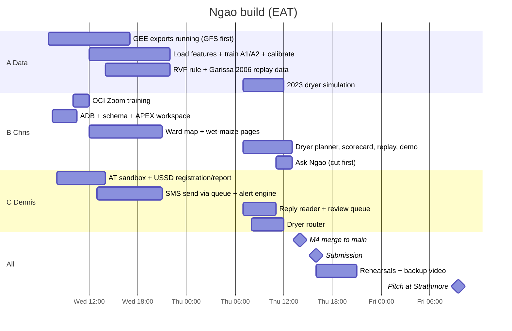

# Execution plan: Wed 14 → Fri 16 Oct 2026 (EAT)

**Scope rule (brief):** build the shared core + farmer service for real, prove herder & health with
replays, present the rest as designed. **Scope freeze Wednesday night.**

| Role | Owner | Branch |
|---|---|---|
| A · Data & models | _TBC_ | `data-*` |
| B · Oracle & dashboard | **Chris** | `frontend-chris` |
| C · Phones & routing | **Dennis** | `backend-dennis` |
| D · Pitch & partners | _TBC_ | n/a |

## Wednesday 14 Oct
| Time | A (data) | B Chris | C Dennis | D (pitch) |
|---|---|---|---|---|
| Morning | Confirm GEE exports (Uasin Gishu GFS archive from Jul 2017 → CHIRPS → ERA5-Land → MODIS; Garissa 2006) | ADB, `NGAO` user, run `db/schema.sql`, APEX workspace, **region check**, OML4Py check · 10–12 OCI Zoom training | AT sandbox, USSD menu tree, ask AT about live sender name · **test OCI GenAI on 10 Swahili replies** | Call NCPB Eldoret, Uasin Gishu agri office, a coop, 5–10 farmers |
| Afternoon | Load `WARD_FEATURES_DAILY`; train + calibrate A1/A2 | Page 1 ward risk map on seed data; page 2 wet maize | USSD registration & reporting write to DB; outbound SMS from `MESSAGES` queue | Send test SMS to farmers; collect real replies |
| Evening | RVF rule + replay table | Page 10 demo controls skeleton | Alert engine: thresholds, abstain, 48 h cooldown, weekly cap, templates | Slide outline |
| **EOD** | **Decide D1 (Django vs ORDS). Scope freeze.** | | | |

## Thursday 15 Oct
| Time | A | B Chris | C Dennis | D |
|---|---|---|---|---|
| 07:00–11:00 | 2023 dryer simulation (with C) | Dryer planner, scorecard, Garissa replay pages | Reply reader live + review queue; dryer router | Deck v1, ≤200-word description |
| 11:00–13:00 | Freeze thresholds (commit hash on slide) | Ask Ngao (if on track); APEX export → git | Router → booking SMS; DLR handling | Backup video script |
| **14:00** | **All PRs merged to `main`** | | | |
| 14:00–15:30 | Three full end-to-end runs; fix only what breaks the demo (all) | | | |
| **16:00** | **Submit** to ilabee@strathmore.edu: repo link, APEX app URL + demo login, description, ≤5-slide deck | | | |
| Evening | Record backup video; two timed rehearsals ≤ 5 min; Thursday-night checklist | | | |

## Friday 16 Oct
Dry run at venue · test hotspot · phone charged · **9:30 AM pitch** · bring National ID.

## Integration milestones

| # | When | Milestone | Proof |
|---|---|---|---|
| M0 | Wed 10:00 | `db/schema.sql` applied in ADB; both can log in to APEX workspace | `SELECT COUNT(*) FROM WARDS` |
| M1 | Wed 14:00 | USSD registration row lands in `SUBSCRIBERS`, visible in APEX | AT simulator → page 1 |
| M2 | Wed 20:00 | Seeded `RISK_SCORES` → **Send alerts** button → SMS in AT simulator / real phone | `MESSAGES` status DELIVERED |
| M3 | Thu 11:00 | Swahili reply → `REPORTS` → appears on map/review queue | page 3 |
| M4 | Thu 13:00 | **Plan routes** → booking SMS; full 7-step demo script runs | end-to-end run #1 |
| M5 | Thu 14:00 | Branches merged to `main`; APEX export committed | PR merged |

## Cut list (cut from the top)
1. Ask Ngao (Select AI) page
2. Cholera map layer
3. Flood and aflatoxin layers
4. Dryer simulation detail (keep headline number)
5. Animated RVF map → static before/after

**Never cut:** the live SMS, the reply that moves a dryer, at least one honest replay.

## Demo script (≈ 1:50 live + 0:40 replay)
| Step | On screen | Narrator |
|---|---|---|
| 1 | USSD simulator: register as *Mkulima*, Uasin Gishu ward, Swahili | "Any phone, no app, no data bundle." |
| 2 | Demo controls → **Run morning scoring**; map shows dry window | "This week's real forecast for these wards." |
| 3 | Phone buzzes with A1 alert | "One action, and how sure we are." |
| 4 | Paste reply *Nimevuna magunia 20, mvua imenyesha, mahindi yana unyevu* | "She replies in Swahili; AI reads it into data." |
| 5 | Report pops onto map → **Plan tomorrow's routes** | "Her point jumps up the list because rain is due in 48 hours." |
| 6 | Phone buzzes with booking SMS | "The dryer comes to her before the rain." |
| 7 | Toggle map to **herd** layer, Garissa | "Same engine, same day, different people." |
| Replay | Page 8: Garissa 2006: Ngao flag date vs first case 30 Nov, peak 24 Dec, vaccination 8 Jan 2007 | "When Ngao would have warned, versus when vaccination began." |

Setup: laptop on projector, basic phone mirrored (scrcpy) or AT simulator, hotspot, backup video on laptop + USB.
Roles: driver, phone holder, narrator. If any step fails → switch to video; never debug on stage.

## Risks
| Risk | Mitigation | Owner |
|---|---|---|
| Too much scope | Farmer live; herder/health via replay; cut list | all |
| OCI GenAI Swahili weak | Test Wed AM; fallback keyword+number matching + USSD menu reports | Dennis |
| Django vs ORDS undecided | Decide Wed EOD; contract is identical either way | Chris + Dennis |
| OML4Py not on Always Free | Train in Python, load scores | A + Chris |
| Live SMS sender name delay | Ask AT Tuesday/Wed; demo with simulator + one real SMS | Dennis |
| Dryer data unknown | Labelled placeholders (`DRYERS.is_placeholder='Y'`) | D |
| USSD callback needs public URL | ORDS has one; else ngrok | Dennis |
| Schema drift between branches | `db/` changes only via small PRs to `main` | both |
| ADB auto-stopped / region lacks a service | Open ADB daily; check region day one | Chris |
| Venue Wi-Fi | Hotspot + backup video | D |
