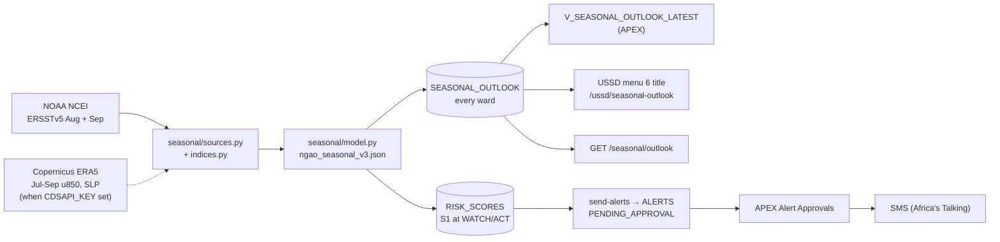

# Seasonal outlook: the v3 El Niño / Indian Ocean model in Ngao

The model in `ngao_elnino_model_v3/` and `ngao_seasonal_model_onepager.pdf` gives each ward, at the end of September, the probability that its October–December short rains will exceed **125% of the 1991–2020 average** (target `y25`). This page explains how that model runs inside Ngao.

## When it runs

- The **scheduler** checks at 07:30 each day from October to December, and issues the season once its inputs exist. NCEI publishes September SST in the first days of October.
- **On demand**: `POST /ngao/v1/jobs/seasonal-outlook` with `{"year": 2026}`, `{"dry_run": true}`, or `{"source": "sst"}`. From APEX, call `ngao_backend.run_job('seasonal-outlook')`.
- Before the September SST exists, the job answers `"status": "waiting_for_data"` and writes nothing.

## Which model variant runs

| Variant | Inputs | Test AUC, y25 (90% CI) | Brier | When |
|---|---|---|---|---|
| `ngao-seasonal-v3-lit6` (recommended v3) | WIO, EIO, DMI, Niño 3.4 SST + central-IO 850 hPa wind + E–W IO pressure gradient | 0.774 (0.43–0.90) | 0.122 | `CDSAPI_KEY` is set and ERA5 July–September is complete |
| `ngao-seasonal-v3-sst4` | the four SST indices only | 0.773 (0.39–0.91) | 0.130 | otherwise. This is the live default for 2026. |

NCEP/NCAR Reanalysis 1, the wind and pressure source the model was trained on, stopped updating in March 2026. ERA5 replaces it live. Each ERA5 box mean is put on the NCEP scale by matching its 1991–2020 mean and spread. The reference values are in the artifact, and the mapping also absorbs ERA5's Pa vs NCEP's hPa.

`SEASONAL_FEATURE_SOURCE` (`auto` by default, or `sst` / `era5`) forces a variant. With `auto`, if ERA5 is configured but fails, the SST-only variant runs and the job's `notes` say so.

The SST-only variant scores as well overall, but it over-forecast 2017 and 2018 (predicted 28% and 36% of wards wet; observed 4% and 9%). The wind and pressure indices removed those false alarms. Prefer the full model when a CDS key is available: register at cds.climate.copernicus.eu, accept the ERA5 licence, and set the key as the `CDSAPI_KEY` GitHub secret.

## What it writes

| Where | What |
|---|---|
| `SEASONAL_OUTLOOK` | One row per ward, season and model version: `probability`, `category` (`HIGH` ≥ 0.5, `MEDIUM` ≥ the model's F1 threshold, else `LOW`), `confidence` (= probability × 100), and `notes` (the tercile probability, the region and the inputs). Re-issuing updates the rows in place. |
| `RISK_SCORES` (`S1`) | For the **current** season only: `ACT` at p ≥ `ALERT_TYPES.act_threshold` (0.5), `WATCH` at p ≥ `watch_threshold` (empty → the model threshold). `send-alerts` drafts ACT alerts per subscriber; officers approve them on APEX page 3. Re-issuing a past season (a check) never creates alerts. |
| `SEASONAL_MODEL_RUNS`, `SEASONAL_BACKTEST` | The model card: test scores and the 2016–2025 backtest, written once per model version. APEX: `V_SEASONAL_MODEL_CARD`, `V_SEASONAL_BACKTEST`. |

`S1` and its SMS copy are added to NgaoDB by `db/deploy/030_seasonal_alert.sql`. Locally, `manage.py seed_reference --templates` adds them.

## Reading it

- `GET /ngao/v1/seasonal/outlook?season=OND%202026&county=Uasin%20Gishu`: per-ward probabilities (API token).
- `GET /ngao/v1/public/seasonal-model-card`: honest scores, backtest and caveats (public).
- `GET /ngao/v1/ussd/seasonal-outlook?phone=...`: the line behind USSD menu 6, whose title becomes e.g. `Oct-Dec 2026: 66% chance of very heavy rains. Choose:`.
- APEX: `V_SEASONAL_OUTLOOK_LATEST` (ward, probability, category, model AUC). A page for it is not yet in app 100: add an Interactive Report or map region on that view in App Builder and export `f100.sql`.

## OND 2026, as issued from the September SST

August–September 2026 Niño 3.4 is 29.48 °C (+3.4 standard deviations against 1951–2015), with a warm western Indian Ocean: a strong El Niño. The SST-only variant gives **56–71% by region**, so every ward is `HIGH`. Because of the 2017–2018 over-forecasts above, treat this as a strong signal to prepare, alongside the official KMD/ICPAC outlook.

## Limits (from the one-pager, still true)

- All wards in a season move together, so 2016–2025 is about 10 independent tests. The AUC confidence interval spans roughly 0.4–0.9.
- June–September ocean conditions did not explain the wet seasons of 2020, 2022, 2024 and 2025.
- The predictors are absolute SST, not detrended, so recent warming nudges the SST-only variant upward.
- Six regions are re-derived (k-means on 1981–2015 rainfall anomalies), because v2's region file was not available. Every ward in a region gets the same probability.
- This is decision support, **not a replacement for the KMD / ICPAC outlook**. The Kiswahili SMS and USSD copy must be checked by a native speaker.

Rebuild or retrain: [data/models/seasonal_v3/README.md](../data/models/seasonal_v3/README.md).
